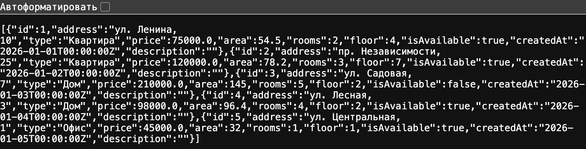
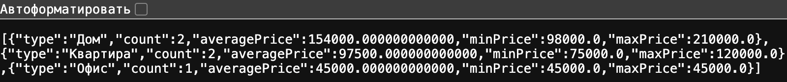
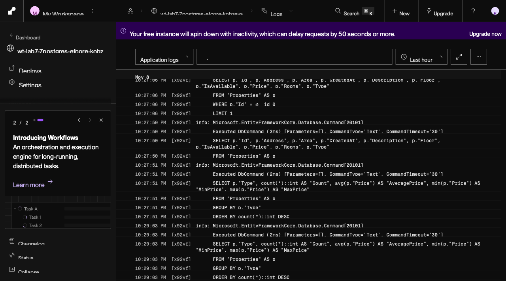
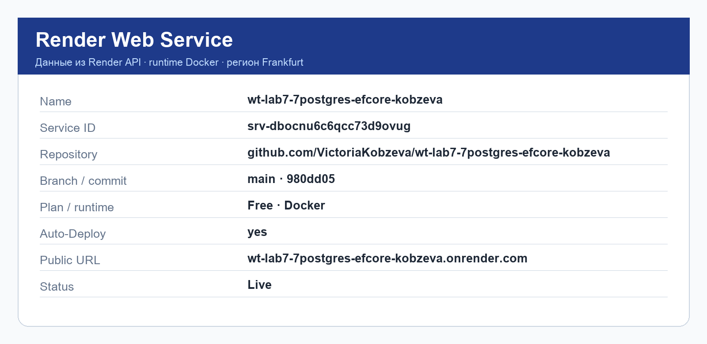
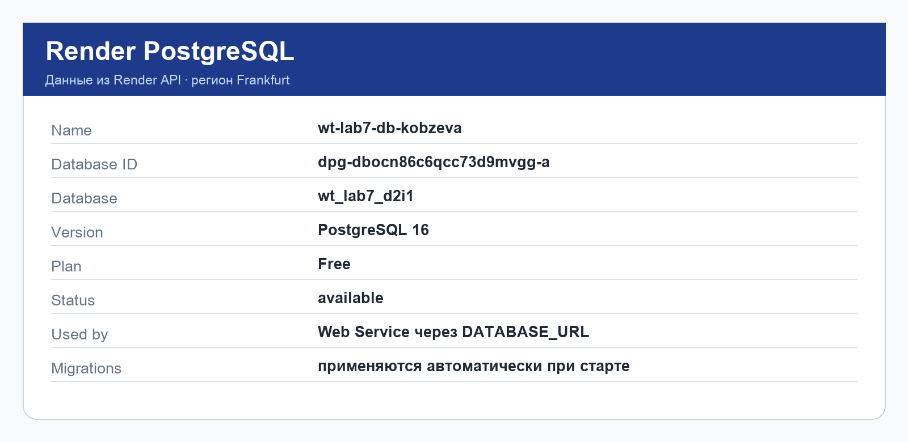
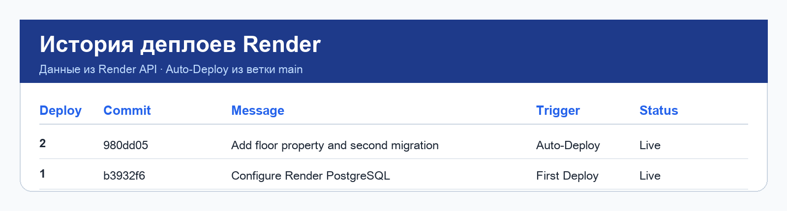
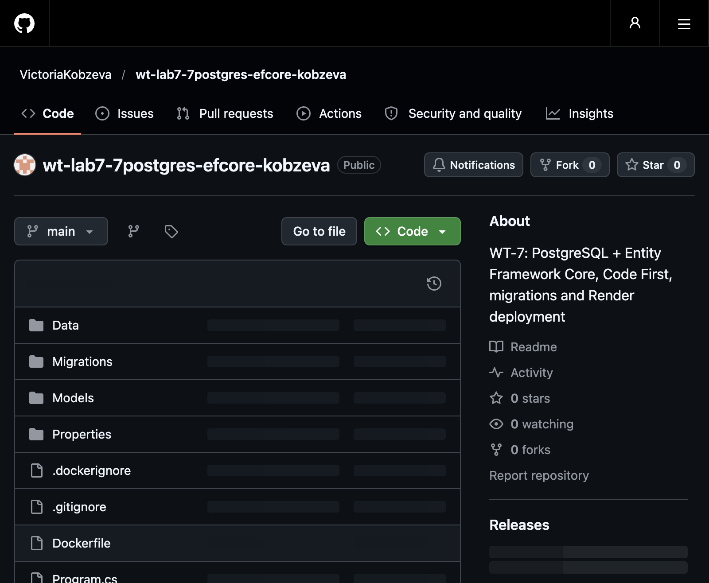

# Лабораторная работа № 7

## PostgreSQL и Entity Framework Core: ORM, Code First, миграции и публикация на Render

**Дисциплина:** Web-технологии  
**Проект:** `wt-lab7-7postgres-efcore-kobzeva`  
**Выполнила:** Кобзева Виктория  
**Дата:** 08.11.2026

---

## 1. Тема и цель работы

**Тема:** подключение PostgreSQL к ASP.NET Core Minimal API через Entity Framework Core,
использование подхода Code First, миграций и публикация приложения на Render.

**Цель:** освоить работу с ORM Entity Framework Core и СУБД PostgreSQL, заменить
хранилище данных в оперативной памяти на базу данных, автоматизировать применение
миграций при запуске приложения.

В ходе работы необходимо было:

- подключить Entity Framework Core к существующему Minimal API из WT-6;
- создать модель и `AppDbContext`;
- создать первую миграцию и структуру базы данных;
- перенести CRUD-операции на EF Core;
- выполнить не менее трёх LINQ-запросов;
- изменить модель и создать вторую миграцию;
- подготовить Dockerfile и опубликовать приложение на Render;
- подключить PostgreSQL на Render и проверить автоматическое применение миграций;
- выполнить повторный Deploy после изменения модели;
- подготовить GitHub-репозиторий и отчёт.

---

## 2. Название проекта и предметная область

Проект создан на основе лабораторной работы № 6: `wt-lab6-6minimalapi-kobzeva`.

**Предметная область:** недвижимость (объекты аренды и продажи).

Основная сущность — `Property`:

| Свойство | Тип | Назначение |
|---|---|---|
| `Id` | `int` | Идентификатор |
| `Address` | `string` | Адрес |
| `Type` | `string` | Тип объекта |
| `Price` | `decimal` | Цена |
| `Area` | `double` | Площадь, м² |
| `Rooms` | `int` | Количество комнат |
| `Floor` | `int` | Этаж |
| `IsAvailable` | `bool` | Доступность |
| `CreatedAt` | `DateTime` | Дата добавления |
| `Description` | `string` | Описание |

Модель содержит идентификатор и девять значимых свойств, что соответствует
требованию «не менее идентификатора и четырёх значимых свойств».

---

## 3. Исходная модель из WT-6

В лабораторной работе № 6 использовалось хранилище `PropertyStore` в оперативной
памяти. Исходная модель выглядела так:

```csharp
public class Property
{
    public int Id { get; set; }
    public string Address { get; set; } = "";
    public string Type { get; set; } = "";
    public decimal Price { get; set; }
    public double Area { get; set; }
    public int Rooms { get; set; }
    public bool IsAvailable { get; set; }
}
```

После перехода на EF Core файл `Data/PropertyStore.cs` удалён: все операции
выполняются через `AppDbContext` и PostgreSQL.

---

## 4. Подключение Entity Framework Core

Установлены пакеты:

```bash
dotnet add package Npgsql.EntityFrameworkCore.PostgreSQL --version 8.0.11
dotnet add package Microsoft.EntityFrameworkCore.Design --version 8.0.11
dotnet tool install --global dotnet-ef --version 8.0.11
```

Провайдер `Npgsql.EntityFrameworkCore.PostgreSQL` обеспечивает работу EF Core
с PostgreSQL. Версии EF Core и провайдера совместимы (8.0.11).

Проверка инструментов:

```text
Entity Framework Core .NET Command-line Tools
8.0.11
```

---

## 5. AppDbContext

Создан каталог `Data` и файл `Data/AppDbContext.cs`:

```csharp
using Microsoft.EntityFrameworkCore;
using wt_lab7_7postgres_efcore_kobzeva.Models;

namespace wt_lab7_7postgres_efcore_kobzeva.Data;

public class AppDbContext : DbContext
{
    public AppDbContext(DbContextOptions<AppDbContext> options)
        : base(options)
    {
    }

    public DbSet<Property> Properties => Set<Property>();

    protected override void OnModelCreating(ModelBuilder modelBuilder)
    {
        modelBuilder.Entity<Property>().HasData(
            new Property { Id = 1, Address = "ул. Ленина, 10", Type = "Квартира",
                Price = 75000, Area = 54.5, Rooms = 2, Floor = 4, IsAvailable = true,
                CreatedAt = new DateTime(2026, 1, 1, 0, 0, 0, DateTimeKind.Utc) },
            new Property { Id = 2, Address = "пр. Независимости, 25", Type = "Квартира",
                Price = 120000, Area = 78.2, Rooms = 3, Floor = 7, IsAvailable = true,
                CreatedAt = new DateTime(2026, 1, 2, 0, 0, 0, DateTimeKind.Utc) },
            new Property { Id = 3, Address = "ул. Садовая, 7", Type = "Дом",
                Price = 210000, Area = 145.0, Rooms = 5, Floor = 2, IsAvailable = false,
                CreatedAt = new DateTime(2026, 1, 3, 0, 0, 0, DateTimeKind.Utc) },
            new Property { Id = 4, Address = "ул. Лесная, 3", Type = "Дом",
                Price = 98000, Area = 96.4, Rooms = 4, Floor = 2, IsAvailable = true,
                CreatedAt = new DateTime(2026, 1, 4, 0, 0, 0, DateTimeKind.Utc) },
            new Property { Id = 5, Address = "ул. Центральная, 1", Type = "Офис",
                Price = 45000, Area = 32.0, Rooms = 1, Floor = 1, IsAvailable = true,
                CreatedAt = new DateTime(2026, 1, 5, 0, 0, 0, DateTimeKind.Utc) }
        );
    }
}
```

`DbContext` является основной точкой взаимодействия приложения с моделью данных
и базой данных. `DbSet<Property>` представляет набор объектов `Property`, с которым
выполняются операции чтения, добавления, изменения и удаления.

---

## 6. Строка подключения

Локально используется `appsettings.Development.json`:

```json
{
  "ConnectionStrings": {
    "DefaultConnection": "Host=localhost;Port=5432;Database=wt_lab7;Username=postgres;Password=your_password"
  }
}
```

Файл добавлен в `.gitignore`, так как может содержать локальный пароль.

На Render используется переменная окружения `DATABASE_URL`. В `Program.cs`
выполняется её преобразование в строку подключения Npgsql:

```csharp
var connectionString = builder.Configuration.GetConnectionString("DefaultConnection");
var databaseUrl = builder.Configuration["DATABASE_URL"];

if (!string.IsNullOrWhiteSpace(databaseUrl))
{
    var uri = new Uri(databaseUrl);
    var userInfo = uri.UserInfo.Split(':', 2);
    var dbPort = uri.Port > 0 ? uri.Port : 5432;
    // Внутреннее подключение Render (host без домена) не использует TLS,
    // внешнее подключение (host с доменом) требует SSL.
    var sslMode = uri.Host.Contains('.') ? "Require" : "Disable";

    connectionString =
        $"Host={uri.Host};" +
        $"Port={dbPort};" +
        $"Database={uri.AbsolutePath.TrimStart('/')};" +
        $"Username={Uri.UnescapeDataString(userInfo[0])};" +
        $"Password={Uri.UnescapeDataString(userInfo[1])};" +
        $"SSL Mode={sslMode}";
}

builder.Services.AddDbContext<AppDbContext>(options =>
    options.UseNpgsql(connectionString));
```

Пароль PostgreSQL не хранится в `Program.cs`, `appsettings.json` или Git-репозитории.
На Render значение `DATABASE_URL` задаётся в настройках Web Service.

---

## 7. Миграции и автоматическое создание структуры

Первая миграция:

```bash
dotnet ef migrations add InitialCreate
dotnet ef database update
```

Затем модель изменялась, и были созданы ещё четыре миграции:

```bash
dotnet ef migrations add AddCreatedAt
dotnet ef migrations add SeedProperties
dotnet ef migrations add AddDescription
dotnet ef migrations add AddFloor
```

Список миграций в проекте:

```text
20261103072107_InitialCreate
20261103072113_AddCreatedAt
20261103072125_SeedProperties
20261103072139_AddDescription
20261108192553_AddFloor
```

Созданы таблицы `Properties` и `__EFMigrationsHistory`. Вся история миграций
хранится в Git, поэтому структура базы воспроизводится при каждом запуске.

При запуске приложение автоматически применяет все неприменённые миграции:

```csharp
var app = builder.Build();

using (var scope = app.Services.CreateScope())
{
    var db = scope.ServiceProvider.GetRequiredService<AppDbContext>();
    db.Database.Migrate();
}
```

Последовательность запуска:

```text
Запуск приложения
      ↓
Подключение к PostgreSQL
      ↓
Проверка миграций
      ↓
Применение отсутствующих миграций
      ↓
Запуск HTTP API
```

`EnsureCreated()` не используется, так как он обходит систему миграций.
`Migrate()` и `EnsureCreated()` одновременно не вызываются.

---

## 8. Структура PostgreSQL

После запуска на Render в базе созданы таблицы:

```text
Properties
__EFMigrationsHistory
```

Столбцы таблицы `Properties`:

| column_name | data_type |
|---|---|
| `Id` | `integer` |
| `Address` | `text` |
| `Type` | `text` |
| `Price` | `numeric` |
| `Area` | `double precision` |
| `Rooms` | `integer` |
| `IsAvailable` | `boolean` |
| `CreatedAt` | `timestamp with time zone` |
| `Description` | `text` |
| `Floor` | `integer` |

SQL-проверка:

```sql
SELECT column_name, data_type
FROM information_schema.columns
WHERE table_name = 'Properties'
ORDER BY ordinal_position;
```

История применённых миграций:

```sql
SELECT "MigrationId"
FROM "__EFMigrationsHistory"
ORDER BY 1;
```

```text
20261103072107_InitialCreate
20261103072113_AddCreatedAt
20261103072125_SeedProperties
20261103072139_AddDescription
20261108192553_AddFloor
```

Структура подтверждена непосредственным подключением к Render PostgreSQL
по внешнему TLS-соединению.

---

## 9. Начальные данные

Через `HasData` добавлены пять объектов недвижимости. Фактическое содержимое
таблицы после второго Deploy:

| Id | Address | Type | Price | Rooms | Floor |
|---:|---|---|---:|---:|---:|
| 1 | ул. Ленина, 10 | Квартира | 75 000 | 2 | 4 |
| 2 | пр. Независимости, 25 | Квартира | 120 000 | 3 | 7 |
| 3 | ул. Садовая, 7 | Дом | 210 000 | 5 | 2 |
| 4 | ул. Лесная, 3 | Дом | 98 000 | 4 | 2 |
| 5 | ул. Центральная, 1 | Офис | 45 000 | 1 | 1 |

Проверка:

```sql
SELECT * FROM "Properties";
```



---

## 10. CRUD через Entity Framework Core

### Получение списка

```csharp
app.MapGet("/api/properties", async (AppDbContext db) =>
{
    var properties = await db.Properties.ToListAsync();
    return Results.Ok(properties);
});
```

### Получение по идентификатору

```csharp
app.MapGet("/api/properties/{id:int}", async (int id, AppDbContext db) =>
{
    var property = await db.Properties.FirstOrDefaultAsync(x => x.Id == id);
    if (property == null)
        return Results.NotFound();
    return Results.Ok(property);
});
```

### Создание

```csharp
app.MapPost("/api/properties", async (Property property, AppDbContext db) =>
{
    if (property.CreatedAt == default)
        property.CreatedAt = DateTime.UtcNow;

    db.Properties.Add(property);
    await db.SaveChangesAsync();

    return Results.Created($"/api/properties/{property.Id}", property);
});
```

### Изменение

```csharp
app.MapPut("/api/properties/{id:int}", async (int id, Property updatedProperty, AppDbContext db) =>
{
    var property = await db.Properties.FirstOrDefaultAsync(x => x.Id == id);
    if (property == null)
        return Results.NotFound();

    property.Address = updatedProperty.Address;
    property.Type = updatedProperty.Type;
    property.Price = updatedProperty.Price;
    property.Area = updatedProperty.Area;
    property.Rooms = updatedProperty.Rooms;
    property.Floor = updatedProperty.Floor;
    property.IsAvailable = updatedProperty.IsAvailable;
    property.Description = updatedProperty.Description;

    await db.SaveChangesAsync();
    return Results.Ok(property);
});
```

### Удаление

```csharp
app.MapDelete("/api/properties/{id:int}", async (int id, AppDbContext db) =>
{
    var property = await db.Properties.FirstOrDefaultAsync(x => x.Id == id);
    if (property == null)
        return Results.NotFound();

    db.Properties.Remove(property);
    await db.SaveChangesAsync();
    return Results.NoContent();
});
```

### Результаты проверки CRUD на опубликованном API

Проверка выполнялась на `https://wt-lab7-7postgres-efcore-kobzeva.onrender.com`.

| Операция | Запрос | Результат |
|---|---|---|
| Create | `POST /api/properties` | `201 Created`, объект получил `Id = 6` |
| Read | `GET /api/properties/6` | `200 OK`, данные объекта |
| Update | `PUT /api/properties/6` | `200 OK`, цена изменена на `99999` |
| Read after update | `GET /api/properties/6` | `200 OK`, `price = 99999`, `rooms = 3` |
| Delete | `DELETE /api/properties/6` | `204 No Content` |
| Read after delete | `GET /api/properties/6` | `404 Not Found` |

После `PUT` запись проверена напрямую в PostgreSQL:

```text
[6, 'ул. Тестовая, 99', 99999, 3, False, 'Цена изменена через PUT']
```

После `DELETE`:

```text
rows with id 6: 0
total rows: 5
```

Это подтверждает, что CRUD выполняется именно через EF Core и PostgreSQL,
а не через хранилище в памяти.

---

## 11. LINQ-запросы

### Фильтрация по цене

```csharp
app.MapGet("/api/properties/filter", async (decimal? minPrice, decimal? maxPrice, AppDbContext db) =>
{
    var query = db.Properties.AsQueryable();

    if (minPrice.HasValue)
        query = query.Where(x => x.Price >= minPrice.Value);

    if (maxPrice.HasValue)
        query = query.Where(x => x.Price <= maxPrice.Value);

    return Results.Ok(await query.ToListAsync());
});
```

### Сортировка по цене

```csharp
query = descending == true
    ? query.OrderByDescending(x => x.Price)
    : query.OrderBy(x => x.Price);
```

### Выборка доступных объектов

```csharp
var properties = await db.Properties
    .Where(x => x.IsAvailable)
    .OrderBy(x => x.Address)
    .ToListAsync();
```

### Собственный запрос: статистика по типам

```csharp
var stats = await db.Properties
    .GroupBy(x => x.Type)
    .Select(g => new
    {
        Type = g.Key,
        Count = g.Count(),
        AveragePrice = g.Average(x => x.Price),
        MinPrice = g.Min(x => x.Price),
        MaxPrice = g.Max(x => x.Price)
    })
    .OrderByDescending(x => x.Count)
    .ToListAsync();
```

Фактический ответ `/api/properties/stats`:

```json
[
  {"type":"Дом","count":2,"averagePrice":154000.0,"minPrice":98000.0,"maxPrice":210000.0},
  {"type":"Квартира","count":2,"averagePrice":97500.0,"minPrice":75000.0,"maxPrice":120000.0},
  {"type":"Офис","count":1,"averagePrice":45000.0,"minPrice":45000.0,"maxPrice":45000.0}
]
```



SQL, сформированный EF Core (виден в логах Render):

```sql
SELECT p."Type", count(*)::int AS "Count", avg(p."Price") AS "AveragePrice",
       min(p."Price") AS "MinPrice", max(p."Price") AS "MaxPrice"
FROM "Properties" AS p
GROUP BY p."Type"
ORDER BY count(*)::int DESC;
```



---

## 12. Изменение модели и миграции

После первой версии базы модель изменялась несколько раз:

1. Добавлено свойство `CreatedAt` — миграция `AddCreatedAt`.
2. Добавлены начальные данные через `HasData` — миграция `SeedProperties`.
3. Добавлено свойство `Description` — миграция `AddDescription`.
4. После первого деплоя на Render добавлено свойство `Floor` — миграция `AddFloor`.

Фрагмент модели:

```csharp
public class Property
{
    public int Id { get; set; }
    public string Address { get; set; } = "";
    public string Type { get; set; } = "";
    public decimal Price { get; set; }
    public double Area { get; set; }
    public int Rooms { get; set; }
    public int Floor { get; set; }
    public bool IsAvailable { get; set; }
    public DateTime CreatedAt { get; set; }
    public string Description { get; set; } = "";
}
```

Миграция `AddFloor`:

```bash
dotnet ef migrations add AddFloor
dotnet ef migrations list
```

После `git push` Render выполнил повторный Deploy, приложение запустилось,
`Database.Migrate()` применил миграцию, и в таблице `Properties` появился столбец
`Floor`.

Полный цикл:

```text
Изменение C#-модели
      ↓
Создание миграции AddFloor
      ↓
Git commit
      ↓
Git push
      ↓
Render Deploy
      ↓
Migrate()
      ↓
Обновление PostgreSQL
      ↓
Обновлённый REST API
```

---

## 13. Dockerfile

```dockerfile
FROM mcr.microsoft.com/dotnet/sdk:8.0 AS build
WORKDIR /src
COPY . .
RUN dotnet restore
RUN dotnet publish -c Release -o /app/publish /p:UseAppHost=false

FROM mcr.microsoft.com/dotnet/aspnet:8.0 AS final
WORKDIR /app
COPY --from=build /app/publish .
EXPOSE 10000
ENTRYPOINT ["dotnet", "wt-lab7-7postgres-efcore-kobzeva.dll"]
```

Приложение читает порт из переменной `PORT`:

```csharp
var port = Environment.GetEnvironmentVariable("PORT") ?? "10000";
app.Run($"http://0.0.0.0:{port}");
```

Docker-образ собирается и запускается на Render в runtime **Docker**.

---

## 14. PostgreSQL и Web Service на Render

На Render созданы:

- PostgreSQL: `wt-lab7-db-kobzeva`, регион Frankfurt, plan Free;
- Web Service: `wt-lab7-7postgres-efcore-kobzeva`, runtime Docker, plan Free;
- переменная окружения `DATABASE_URL` — Internal Database URL созданной базы.

Web Service подключён к GitHub-репозиторию:

```text
https://github.com/VictoriaKobzeva/wt-lab7-7postgres-efcore-kobzeva
```

Используется ветка `main` и `Dockerfile` в корне репозитория.





Значения `DATABASE_URL`, пароля и полной строки подключения в отчёт не включены.

---

## 15. Деплой и логи запуска

Первый Deploy выполнен после коммита `b3932f6` («Configure Render PostgreSQL»).
Второй Deploy — после коммита `980dd05` («Add floor property and second migration»).

История деплоев:

| Deploy | Коммит | Триггер | Результат |
|---|---|---|---|
| 1 | `b3932f6` | First Deploy | Live |
| 2 | `980dd05` | Auto-Deploy | Live |



В логах видно, что приложение подключается к PostgreSQL, EF Core выполняет
SQL-запросы к таблице `Properties`, а также применяет миграции при старте.

---

## 16. Проверка REST API после публикации

Публичный URL:

```text
https://wt-lab7-7postgres-efcore-kobzeva.onrender.com
```

| Метод | Endpoint | Результат |
|---|---|---|
| GET | `/` | `200 OK`, `Minimal API работает!` |
| GET | `/api/info` | `200 OK`, JSON с информацией о приложении |
| GET | `/api/properties` | `200 OK`, пять объектов из PostgreSQL |
| GET | `/api/properties/1` | `200 OK`, объект с `Id = 1` |
| GET | `/api/properties/999` | `404 Not Found` |
| GET | `/api/properties/search?search=дом` | `200 OK`, поиск по адресу/типу/описанию |
| GET | `/api/properties/filter?minPrice=100000&maxPrice=250000` | `200 OK`, два объекта |
| GET | `/api/properties/sorted?descending=true` | `200 OK`, сортировка по цене |
| GET | `/api/properties/available` | `200 OK`, доступные объекты |
| GET | `/api/properties/stats` | `200 OK`, статистика по типам |
| POST | `/api/properties` | `201 Created` |
| PUT | `/api/properties/6` | `200 OK` |
| DELETE | `/api/properties/6` | `204 No Content` |


---

## 17. Повторная публикация и обновление структуры PostgreSQL

После первого Deploy в модель добавлено свойство `Floor`, создана миграция
`AddFloor`, изменения отправлены в GitHub. Render автоматически выполнил новый
Deploy.

После второго Deploy проверено:

- в таблице `Properties` появился столбец `Floor` типа `integer`;
- в `__EFMigrationsHistory` появилась запись `20261108192553_AddFloor`;
- API возвращает поле `floor`:

```json
{
  "id": 1,
  "address": "ул. Ленина, 10",
  "type": "Квартира",
  "price": 75000.0,
  "area": 54.5,
  "rooms": 2,
  "floor": 4,
  "isAvailable": true,
  "createdAt": "2026-01-01T00:00:00Z",
  "description": ""
}
```

Это подтверждает полный цикл автоматического обновления базы данных:

```text
C#-модель
      ↓
DbContext
      ↓
Миграция
      ↓
Git push
      ↓
Render Deploy
      ↓
Database.Migrate()
      ↓
PostgreSQL
      ↓
REST API
```

---

## 18. GitHub-репозиторий

Репозиторий: <https://github.com/VictoriaKobzeva/wt-lab7-7postgres-efcore-kobzeva>

История коммитов:

```text
980dd05 Add floor property and second migration
b3932f6 Configure Render PostgreSQL
5ed8917 Add EF Core migrations
b218689 Add PostgreSQL and EF Core
```

В репозитории хранятся:

- исходный код Minimal API;
- модель `Property`;
- `AppDbContext`;
- все миграции;
- `Dockerfile`;
- `README.md`;
- отчёт `REPORT.md` и PDF-версия отчёта.

`appsettings.Development.json` с локальным паролем в Git не отправляется.



---

## 19. Вывод

В ходе работы изучены Entity Framework Core, подход Code First, механизм миграций
и работа с PostgreSQL. Хранилище в оперативной памяти заменено на базу данных,
реализованы CRUD-операции и LINQ-запросы через `AppDbContext`.

Настроено автоматическое применение миграций при запуске приложения, подготовлен
Dockerfile и выполнена публикация на Render. Проверено, что после изменения модели
и повторного Deploy структура PostgreSQL обновляется автоматически, а REST API
продолжает возвращать актуальные данные из базы.

---

## 20. Ссылки

- **GitHub-репозиторий:** <https://github.com/VictoriaKobzeva/wt-lab7-7postgres-efcore-kobzeva>
- **Публичный URL Render:** <https://wt-lab7-7postgres-efcore-kobzeva.onrender.com>
- **Render PostgreSQL:** `wt-lab7-db-kobzeva`
- **Render Web Service:** `wt-lab7-7postgres-efcore-kobzeva`
